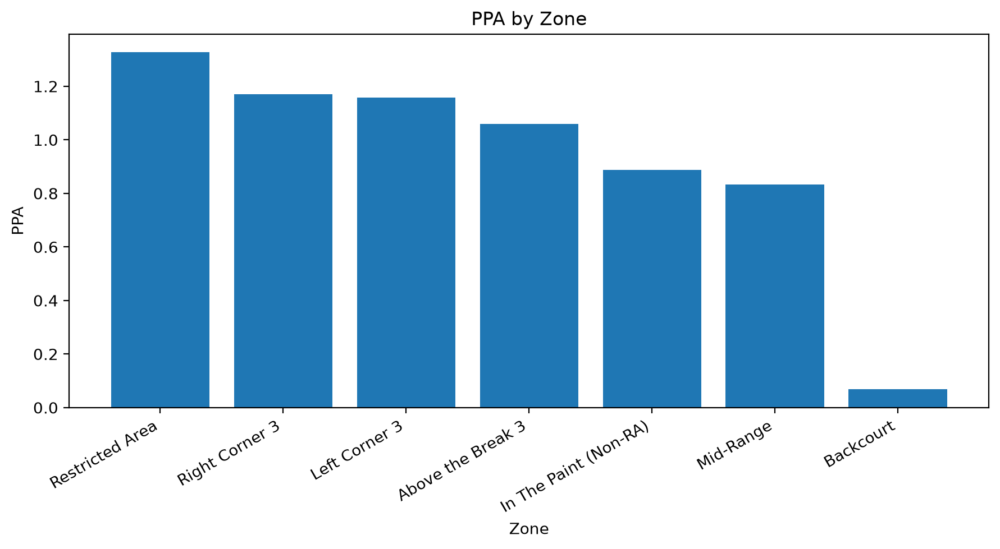
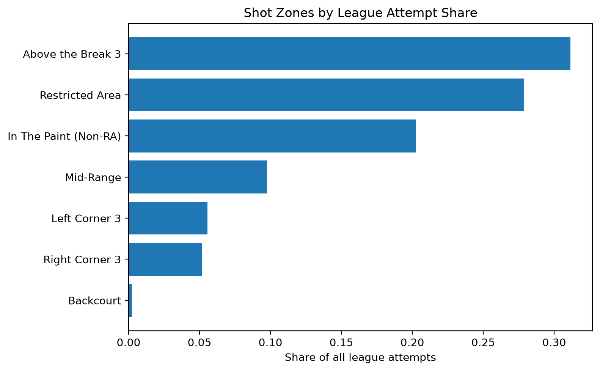
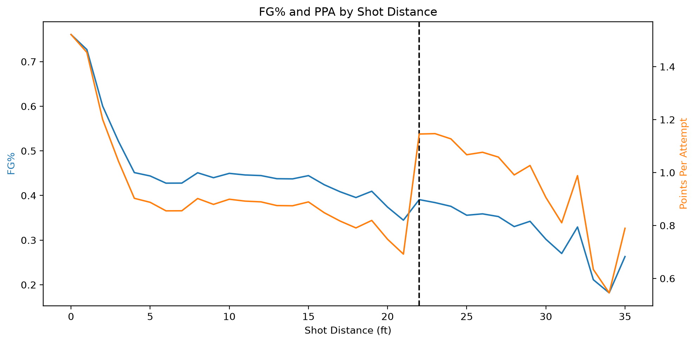
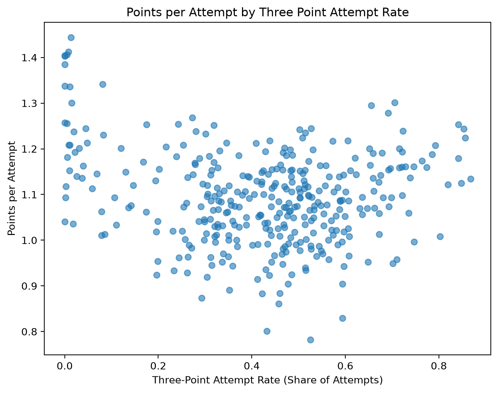
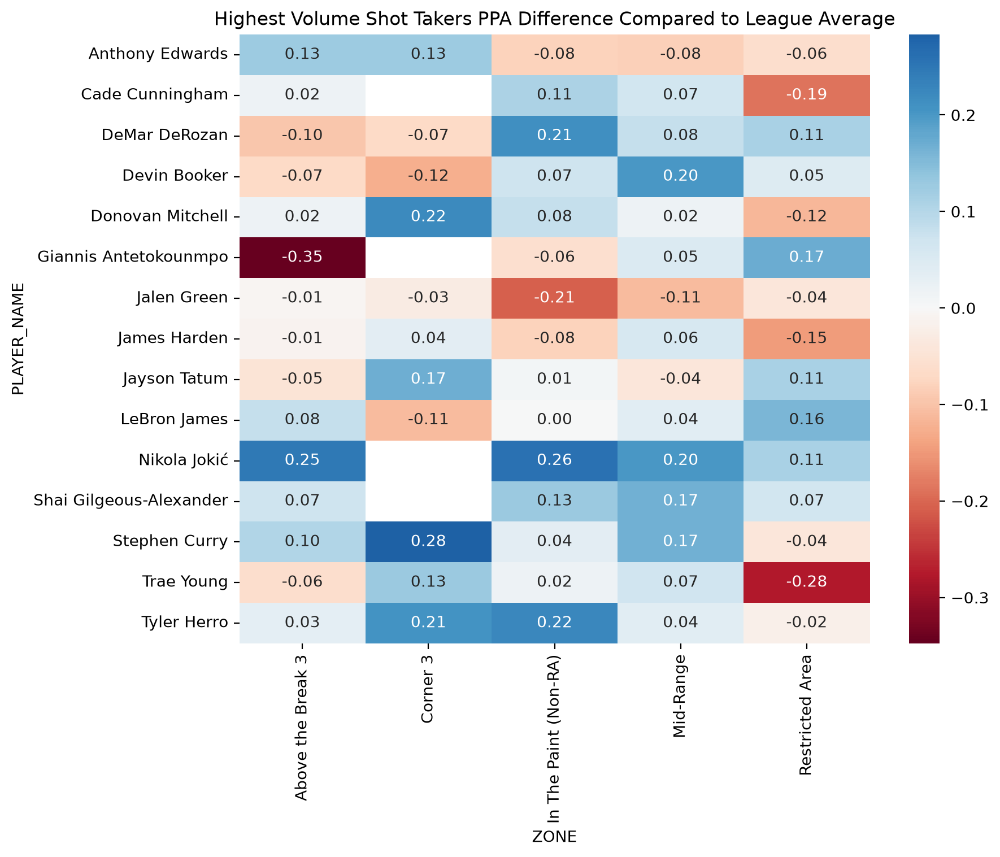

# NBA Shot Selection & Scoring Efficiency Analysis

An analysis of every shot taken in the 2024-25 NBA regular season (about 220,000 attempts) to see how shot location and shot selection affect scoring efficiency, and which players beat the league average in different parts of the court.

This is my second independent Python data project. My first one used box-score stats (points and shooting percentages). This time I wanted to use actual shot-by-shot data instead, because field-goal percentage by itself doesn't tell you how many points a shot is worth.

## Research Questions

1. How does scoring efficiency change across court zones, and which zones are the most efficient?
2. How do two-point and three-point attempts compare?
3. How does efficiency change with shot distance?
4. How do individual players differ in shot selection, and are players who shoot more threes more efficient?
5. Which players do better or worse than the league average in specific zones, and does overall efficiency hide anything?

## Dataset

- **Source:** NBA Stats shot chart data, pulled through the [nba_api](https://github.com/swar/nba_api) Python package (ShotChartDetail endpoint)
- **Season:** 2024-25 regular season
- **Size after pulling:** 219,527 shots, 1,230 games, 566 players, from October 22, 2024 to April 13, 2025
- **Columns:** 24 columns, including player, team, quarter, shot type (2PT or 3PT), shot zone, shot distance, court coordinates, and whether the shot was made

The CSV is not stored in this repo because of its size. See [data/README.md](data/README.md) for how to recreate it.

## Tools and Libraries

Python, pandas, NumPy, Matplotlib, seaborn, nba_api, and Jupyter (run in VS Code).

## Data Preparation

- **Getting the full season:** I first tried requesting the whole league in one call. It returned exactly 102,400 rows, but only 577 of the 1,230 games, ending on March 17. LeBron James also had only 627 shots in that pull, compared to 1,270 when I pulled him alone. So the response had been cut off without any error message. I fixed this by pulling each of the 30 teams separately (with a short pause between requests) and combining the results.
- **Checking the pull:** The final data has all 1,230 games, 30 teams, and dates through April 13. LeBron's shot count matched his individual pull (1,270).
- **Cleaning:** I checked for duplicate rows and missing values before doing any analysis. I also read the game ID column as text, since pandas otherwise drops the leading zeros.
- **Points column:** I created a points column (0 for a miss, 2 for a made two, 3 for a made three). I checked that all missed shots add up to 0 points and that the column only contains 0, 2, and 3.

## Methodology

**Metrics**

- **FG%** = makes / attempts
- **Points per attempt (PPA)** = total points / total attempts. Unlike FG%, this counts a three as worth more than a two, so shots from different zones can be compared fairly.
- **Attempt share** = a zone's attempts / total attempts
- **Three-point rate** = a player's three-point attempts / their total attempts

**Distance analysis:** Shots were grouped into 1-foot bins from 0 to 36 feet. Shots at 36+ feet were left out of this part since there are very few of them.

**Player comparisons:** To avoid tiny samples, I only included players above a minimum number of attempts. For the player-level tables, the minimum was 174 attempts (found by taking the minimum number of games to qualify for end of season stats leader awards (which is 58 games) and multiplying that by a minimum of 3 shots per game.).

**Benchmarking (player vs. league):**
1. Calculated the league PPA for each zone.
2. Calculated each player's PPA in each zone.
3. PPA difference = player PPA minus league PPA in that zone.
4. Points vs. league = PPA difference x the player's attempts, which gives the total points gained or lost compared to a league-average shooter on the same shots.

For this part I combined Left Corner 3 and Right Corner 3 into one Corner 3 zone and dropped Backcourt (it had too few attempts). Players needed at least 50 attempts in a zone, except Corner 3, where I used 30. Corner threes are rare for players who handle the ball a lot, and a 50-attempt rule would have removed a lot of high-usage players from that zone.

## Key Findings

**1. The restricted area and corner threes are the most efficient shots, and mid-range is the least.**
Restricted area shots average 1.327 points per attempt and corner threes average 1.158 (left) and 1.170 (right). Above-the-break threes average 1.060, in-the-paint shots outside the restricted area 0.887, and mid-range shots 0.834.

**2. FG% can point the wrong way.**
Mid-range shots go in more often than above-the-break threes (41.7% vs. 35.3%), but they produce far fewer points per shot (0.834 vs. 1.060), because a three is worth 50% more.

**3. The average two and the average three are almost equally efficient. Where the shot is taken matters more.**
League-wide, two-pointers average 1.090 PPA (54.5% FG) and threes average 1.081 (36.0% FG). Corner threes at about 1.16-1.17 clearly beat above-the-break threes at 1.06.

**4. Teams take most of their shots from the most efficient areas.**
About 70% of all attempts come from the restricted area or three-point range (above the break 31.1%, restricted area 27.9%, corner threes 10.8% combined). Mid-range makes up only 9.7% of attempts.

**5. Shot distance and efficiency.**
PPA drops as shots move away from the rim. On the chart there is also a dip for long twos around 20-21 feet, and then PPA jumps back up once the shot becomes a three. The lowest PPA of any distance is at 34-35 feet (0.545), which makes sense because those are very deep, difficult shots. My explanation for the dip at 20-21 feet is that long twos are difficult shots that are only worth two points.

**6. Players who shoot more threes are not necessarily more efficient.**
Among the 351 qualified players, the correlation between three-point rate and PPA is -0.175, a weak negative relationship. The players with the highest PPA were mostly the ones who take the fewest threes. I think this is because they mostly shoot near the rim, but I did not test that (see Limitations). This is also only an association and doesn't show that shooting threes lowers efficiency.

**7. Overall efficiency can hide zone strengths and weaknesses.**
Among the 15 players with the most total attempts, the benchmark heatmap shows some big differences between zones. Giannis Antetokounmpo is about 0.35 PPA below the league average on above-the-break threes but about 0.17 above average in the restricted area. Cade Cunningham is about 0.19 below the league average in the restricted area, which his overall PPA doesn't show.

**Players with the biggest gaps.** The largest gaps above league average in each zone were, for example, Kai Jones in the restricted area (+0.566 PPA on 75 attempts), Garrison Mathews on corner threes (+0.575 on 69 attempts), and Ty Jerome in mid-range (+0.335 on 65 attempts) and in-the-paint shots (+0.270 on 209 attempts). Several of these are close to the attempt minimum, so they should be read with caution.

## Visualizations

**PPA by zone**



**Share of attempts by zone**



**FG% and PPA by shot distance** (dashed line at 22 ft, where the corner three starts)



**Three-point rate vs. PPA for qualified players**



**Player PPA vs. league average by zone** (the 15 players with the most attempts)



## Limitations

- **One season only.** Results for a single year can be noisy, and I can't say whether these patterns hold in other seasons.
- **Shot difficulty isn't in the data.** The data doesn't include how closely a shot was defended, so a good PPA could come from open looks and not from skill.
- **Minimum attempts are arbitrary.** I chose 50 attempts per zone (30 for corner threes). Different cutoffs would change which players show up in the tables, and some players near the cutoff have noisy numbers.
- **The league benchmark includes each player's own shots.** This matters little for most players but slightly affects players with very high volume.
- **PPA only covers shots.** It ignores free throws, turnovers, and assists.
- **Correlation isn't causation.** The three-point rate result is only an association.
- **Untested explanation.** I think big men near the rim explain why low-three-point-rate players have the highest PPA, but I did not check this.
- **Distance bins stop at 36 feet,** and Backcourt has very few attempts (517, with a 2.3% FG%), so its numbers aren't meaningful.
- **Unofficial API.** nba_api is community-maintained, so the data pull could break or return different results later.

## Future Improvements

- Test whether big men near the rim explain the weak three-point rate vs. PPA relationship
- Add more seasons to see whether the zone results change over time
- Use the quarter column to look at how shot selection changes late in games
- Add team-level comparisons
- Try simple modeling (for example, predicting whether a shot goes in from distance and zone) as a stretch goal

## How to Reproduce

1. Clone the repo and create a virtual environment:
   ```
   python -m venv .venv
   ```
2. Activate it, then install the libraries:
   ```
   pip install -r requirements.txt
   ```
3. Open notebooks/shot_analysis.ipynb and run the data pull section once (it takes several minutes because it makes 30 requests with pauses in between). This saves the CSV to the data folder.
4. Run the rest of the notebook from top to bottom. The charts are saved to the visualizations folder.

## Repository Structure

```
nba-shot-selection-analysis/
├── data/
│   └── README.md
├── notebooks/
│   └── shot_analysis.ipynb
├── visualizations/
├── README.md
└── requirements.txt
```